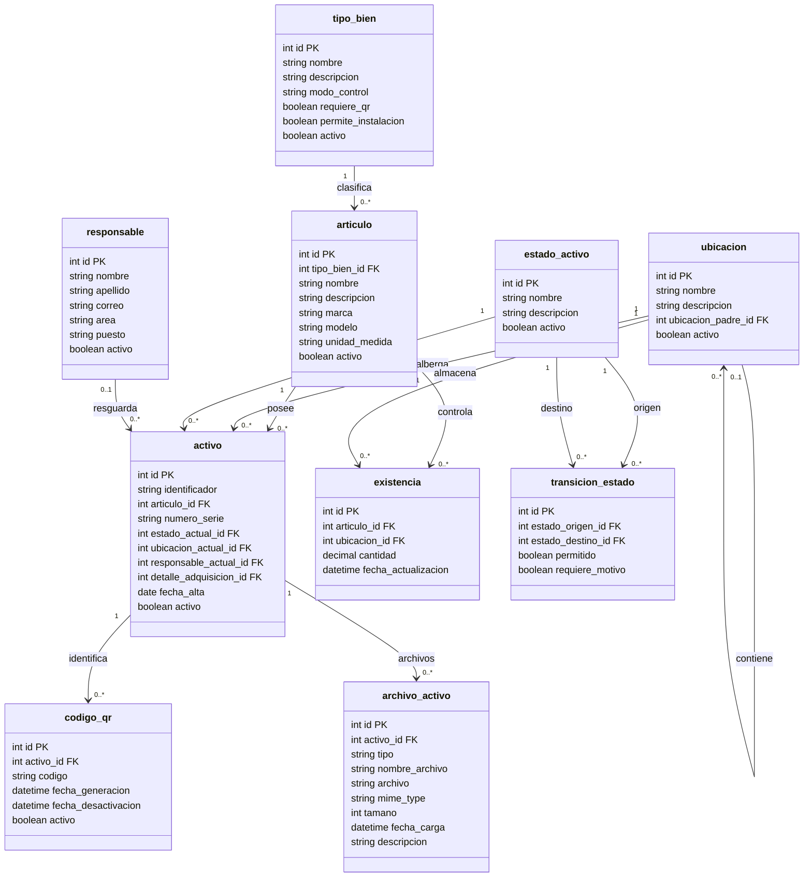
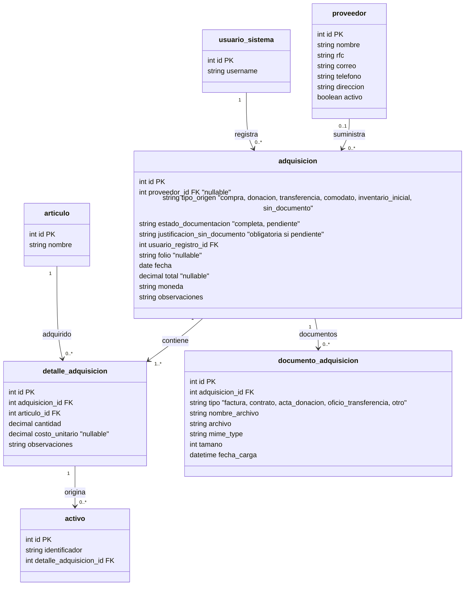
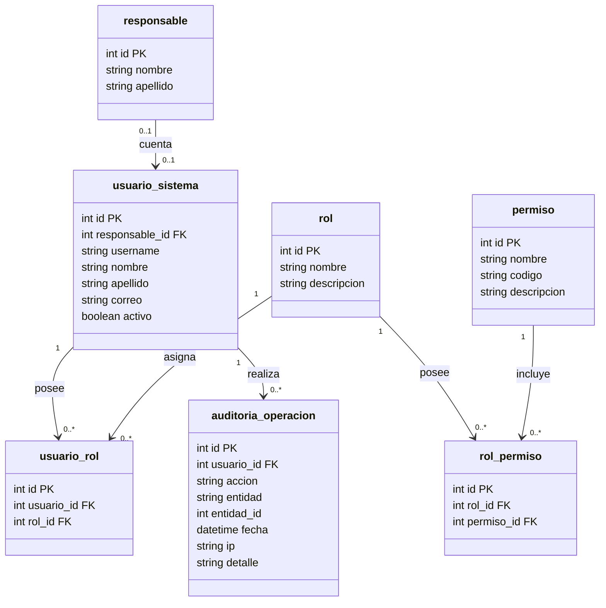

# Modelo de clases — vistas

Cada vista es un diagrama independiente. Las clases que aparecen solo con `id` son referencias a entidades que se detallan en otra vista.

| # | Vista | Alcance de esta etapa |
|---|-------|-----------------------|
| 1 | Núcleo de inventario | Sí |
| 2 | Adquisiciones y documentos de origen (incluye activos sin factura) | Sí |
| 3 | Usuarios, roles, permisos y auditoría | Sí |
| 4 | Trazabilidad e historial | Sí |
| 5 | Tickets, incidencias y reparaciones | Extensión futura |
| 6 | Garantías, mantenimiento y alertas | Extensión futura |
| 7 | Reservas, préstamos y bajas | Extensión futura |
| 8 | Integraciones e importaciones | Extensión futura |

---

## Vista 1. Núcleo de inventario

---

## Vista 2. Adquisiciones y documentos de origen

Esta vista incluye el ajuste para registrar activos **sin factura**. Los campos nuevos o modificados están marcados con `%% CAMBIO`.

### Flujo para dar de alta un activo sin factura

1. Se crea una `adquisicion` con `tipo_origen` (por ejemplo `sin_documento` o `inventario_inicial`), `estado_documentacion = pendiente`, `proveedor_id` y `folio` vacíos, y una `justificacion_sin_documento` obligatoria.
2. Se crea su `detalle_adquisicion` con `costo_unitario` vacío (el costo es desconocido).
3. Se crea el `activo` ligado a ese detalle, de modo que el activo siempre tiene documento de origen aunque sea provisional.
4. Cuando aparece la factura (o contrato, acta, oficio), se agrega un `documento_adquisicion`, se completan proveedor, folio y costos, y `estado_documentacion` pasa a `completa`. No se cambia el `activo` ni su historial.
5. Filtrar `adquisicion` por `estado_documentacion = pendiente` da la lista de activos por regularizar.

---

## Vista 3. Usuarios, roles, permisos y auditoría

---

